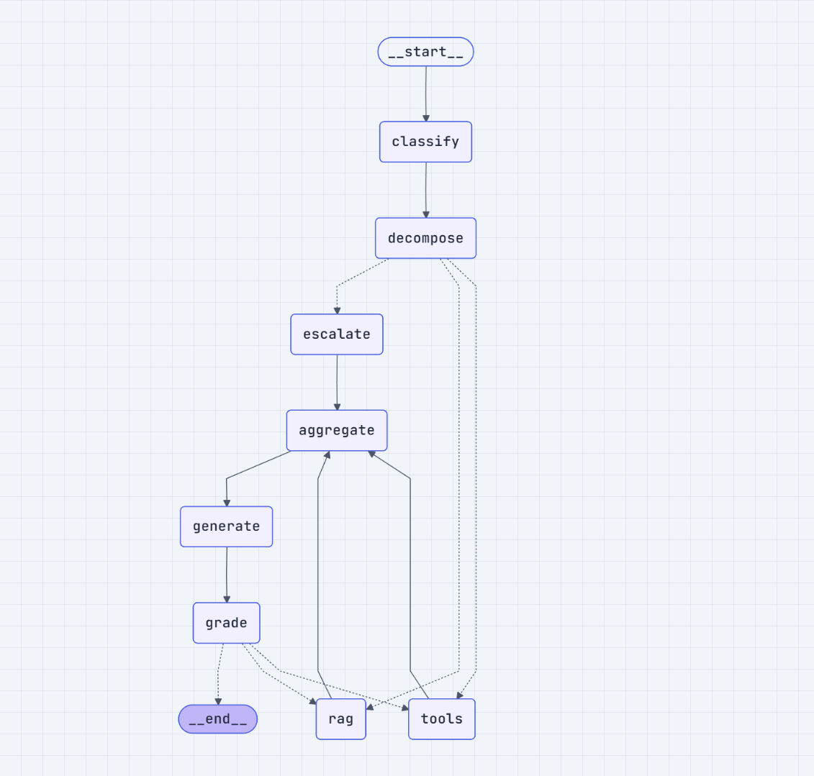
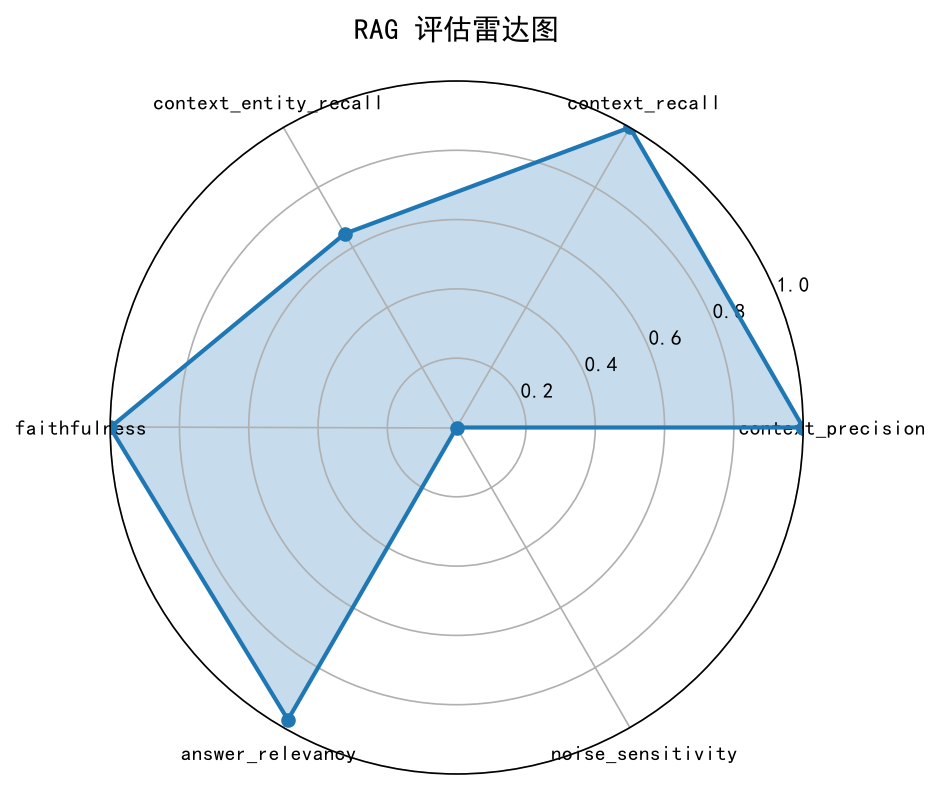

# 🧠 Agentic RAG 智能问答系统 (基于 LangGraph)

这是一个基于 **Python、LangChain 与 LangGraph** 构建的高级多意图 Agent 系统。系统采用了 **Agentic RAG** 架构，不仅支持基础的混合知识库检索，还支持真实外部工具调用（如查订单）、多意图并发拆解、以及基于 LLM 的自校验动态纠错（Self-Correction）。

## ✨ 核心特性

*   **多意图并发与细粒度路由**：使用 LLM 结构化输出进行意图识别，基于 LangGraph `Send API` 实现多路并行分发。结合正则规则过滤纯数字，实现精准子任务路由，避免算力浪费。
*   **混合检索与重排 (Hybrid RAG)**：实现 Vector (ChromaDB) + BM25 双路召回，结合 RRF (Reciprocal Rank Fusion) 融合算法与 CrossEncoder (Qwen3-Reranker) 重排，大幅提高检索精度。
*   **Self-Correction 动态纠错**：引入 LLM 质检官节点，利用 LangGraph `Command` 实现动态路由。发现幻觉或漏答时自动回退至对应节点重试，并设置重试上限防止死循环。
*   **企业级并发控制**：针对多线程并发调用本地模型（Chroma / BM25 / PyTorch）的底层资源冲突，引入 `threading.Lock` 实现资源隔离，彻底解决 SQLite 死锁及 `meta tensor` 崩溃问题。
*   **真实 API 交互与容错**：设计带 `Bearer Token` 鉴权的真实 HTTP 请求逻辑，包含 `timeout` 超时控制与细粒度异常捕获，在后端服务断连时实现优雅降级。
*   **量化评估与日志监控**：基于 RAGAS 构建量化评估体系，配置 `RotatingFileHandler` 实现结构化日志的自动轮转，保障线上排错能力。

---

## 🏗️ 系统架构图

系统使用 LangGraph 编排，具备完整的并行分发与质检纠错闭环：



---

## 📊 RAGAS 量化评估

项目使用 RAGAS 框架对 RAG 链路进行了 12 条标注数据的量化评估。以下是核心指标：



| 评估指标 (Metrics) | 分数 (Score) | 说明 (Description)                |
| :--- |:-----------|:--------------------------------|
| **Context Precision** | `1.000`    | 检索精度，满分说明召回内容全为干货。              |
| **Context Recall** | `1.000`    | 检索召回率，满分说明该找到的都找到了。             |
| **Context Entity Recall** | `0.646`    | 实体召回率，通过 Query 拆解优化从 0.43 显著提升。 |
| **Faithfulness** | `1.000`    | 答案忠实度，满分说明大模型完全没有幻觉。            |
| **Answer Relevancy** | `0.974`    | 答案相关性，回答高度切题。                   |
| **Noise Sensitivity** | `0.000`    | 噪声敏感度（越低越好），说明系统抗噪能力极强。         |

---

## 🛠️ 技术栈

*   **核心语言**：Python 3.10+
*   **Agent 编排**：LangChain, LangGraph
*   **大语言模型**：DEEPSEEK,Qwen-Plus (通义千问)
*   **向量检索**：ChromaDB, DashScope Embedding
*   **关键词检索**：BM25s, pkuseg
*   **重排模型**：Sentence-Transformers (Qwen3-Reranker-0.6B)
*   **评估框架**：RAGAS

---

## 🚀 快速开始

### 1. 安装依赖

```bash
git clone <your-repo-url>
cd knowledge_base_agent
pip install -e .
```

### 2. 配置环境变量

在项目根目录创建 `.env` 文件，填入你的 API Keys（请勿提交到 Git）：

```env
DEEPSEEK_API_KEY=your_key
DEEPSEEK_BASE_URL=https://api.deepseek.com
DASHSCOPE_API_KEY=your_key
DASHSCOPE_BASE_URL=https://dashscope.aliyuncs.com/compatible-mode/v1
ORDER_API_URL=http://127.0.0.1:8000/v1/order
ORDER_API_TOKEN=my-super-secret-token
```

### 3. 构建知识库索引

```bash
python -m src.rag_engine.build_index
```

### 4. 启动本地 Mock API（可选）

启动模拟订单接口的后端服务：

```bash
uvicorn mock_server:app --port 8000
```

### 5. 运行 Agent 开始对话

```bash
python main.py
```

### ✨ 推荐测试用例（多意图并发）

*   `孔子的教育思想是啥,大教育论是谁写的`
*   `帮我查询订单12345和订单345226;孔子的思想是啥`（触发多路并发与细粒度路由）

---

## 📂 项目结构

```text
knowledge_base_agent/
├── main.py                     # 程序入口
├── mock_server.py              # 模拟订单 API 服务
├── src/                        # 核心业务代码 (config, state, nodes, graph 等)
├── evaluation/                 # RAGAS 评估数据集与脚本
├── data/                       # 数据目录 (raw 存放 md, vector_store 存放向量库)
└── pyproject.toml              # 依赖配置
```

---

## 🛡️ 遇到的挑战与解决方案

### 1. 并发检索崩溃 (SQLite Lock & C-extension)

*   **问题**：多线程并发访问本地 ChromaDB 导致 SQLite 死锁，同时读取 BM25 引发指针冲突。
*   **解法**：在 `retriever.py` 中引入 `threading.Lock` 实现资源隔离，保证并发安全。

### 2. 大模型加载报错 (Meta Tensor)

*   **问题**：并发调用 CrossEncoder 导致 PyTorch 报 meta tensor 错误。
*   **解法**：使用双重检查锁 (Double-Checked Locking) 控制模型单例加载。

### 3. LLM 参数提取不稳定

*   **问题**：Qwen 模型提取订单号返回 `null`。
*   **解法**：增加具体 Prompt 示例，并强制约束 JSON 输出。

### 4. API 限流 (429 Rate Limit)

*   **问题**：高并发调用大模型触发了限流。
*   **解法**：在 Tools 节点添加 LLM 并发锁，实现排队提取。
